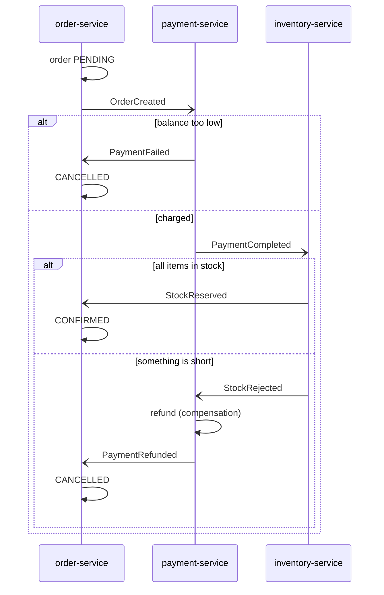
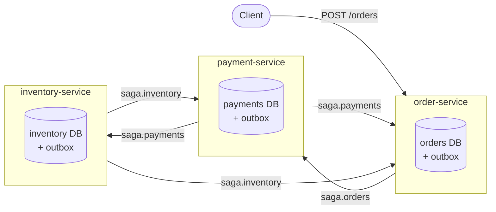
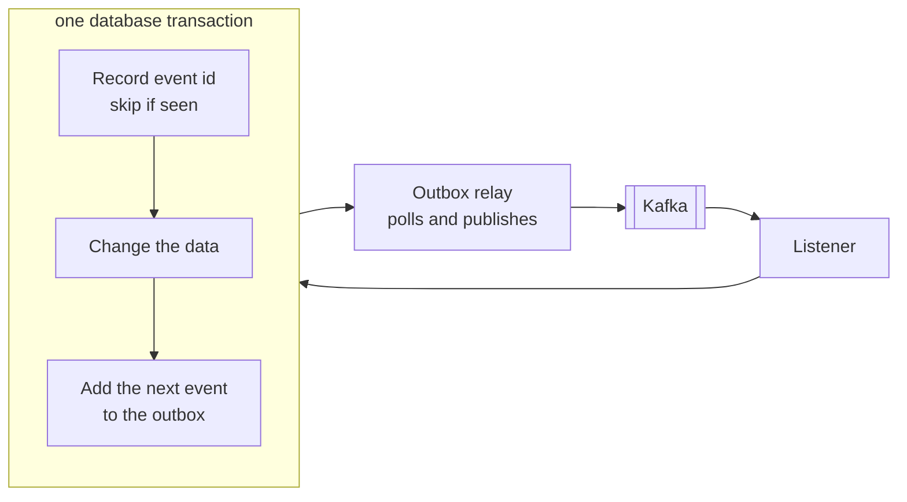

# Payment Saga Microservices

[](https://github.com/Adri23Ausin/payment-saga-microservices/actions/workflows/ci.yml)


Three microservices (orders, payments, inventory), each with its own database, that complete an order together without a distributed transaction. They coordinate through a **choreographed saga** over Kafka: every service reacts to the others' events, and when stock runs out after the customer has paid, a **compensating step** refunds the charge. A **transactional outbox**, **idempotent consumers** and **dead-letter topics** make it safe against crashes, redeliveries and bad messages.

### Author: Adrián Ausín Cuesta

## Contents

1. [The saga](#the-saga)
2. [Tech stack](#tech-stack)
3. [Architecture](#architecture)
4. [Run it](#run-it)
5. [API](#api)
6. [Tests](#tests)
7. [Design decisions](#design-decisions)
8. [Possible improvements](#possible-improvements)

## The saga



This is a real run against the Docker Compose stack:

```
alice: CONFIRMED
    ORDER_PLACED
    PAYMENT_COMPLETED - EUR 138.90 charged
    STOCK_RESERVED

bob: CANCELLED (Insufficient funds)
    ORDER_PLACED
    PAYMENT_FAILED - Insufficient funds

carol: CANCELLED (Out of stock (WEBCAM: 1 requested, 0 available), payment refunded)
    ORDER_PLACED
    PAYMENT_COMPLETED - EUR 59.00 charged
    STOCK_REJECTED - WEBCAM: 1 requested, 0 available
    PAYMENT_REFUNDED - EUR 59.00 refunded
```

## Tech stack

| Area | Technology |
|---|---|
| Language | Java 21 (sealed interfaces, records, pattern matching for `switch`) |
| Services | Spring Boot 4.1, Spring MVC, Spring for Apache Kafka, `JdbcClient`, Flyway, Bean Validation |
| Messaging | Kafka 4.2 (KRaft), one topic per publishing service, keyed by order id |
| Data | PostgreSQL 17, one database per service |
| Tests | JUnit 5, AssertJ, Testcontainers (PostgreSQL, Kafka), Awaitility, `MockMvcTester`, an end-to-end module |
| Build & delivery | Multi-module Maven, one Dockerfile for every service, Docker Compose with Kafka UI, GitHub Actions |

## Architecture



```
saga-common/        # Events, outbox, idempotent consumers, dead-lettering (a Spring Boot auto-configuration)
order-service/      # Places orders and decides how their saga ends
payment-service/    # Charges accounts and refunds them
inventory-service/  # Reserves stock, all or nothing
saga-e2e/           # End-to-end tests with the three services running together
```

Inside every service, handling an event is one database transaction:



## Run it

Requires **Docker**. To run outside Docker you also need **JDK 21**.

```bash
docker compose --profile app up --build
```

| Service | URL |
|---|---|
| order-service | http://localhost:8080 |
| payment-service | http://localhost:8081 |
| inventory-service | http://localhost:8082 |
| Kafka UI | http://localhost:8090 |

The demo data has three customers (alice with EUR 1000, bob with EUR 50, carol with EUR 250) and four products (plenty of `KEYBOARD` and `MOUSE`, two `MONITOR`s and no `WEBCAM`). [`requests.http`](requests.http) has an order for each ending. Host ports can be changed with `ORDER_PORT`, `PAYMENT_PORT`, `INVENTORY_PORT`, `POSTGRES_PORT`, `KAFKA_PORT` and `KAFKA_UI_PORT`.

## API

| Service | Method | Path | Description |
|---|---|---|---|
| order | `POST` | `/api/v1/orders` | Place an order: `{"customerId": "alice", "items": [{"sku": "MOUSE", "quantity": 2, "unitPrice": 24.50}]}`. `202`, pending |
| order | `GET` | `/api/v1/orders/{id}` | The order with its status, reason and history of saga steps |
| order | `GET` | `/api/v1/orders?customerId=alice` | A customer's latest orders |
| payment | `GET` | `/api/v1/accounts/{customerId}` | Balance |
| payment | `GET` | `/api/v1/payments/{orderId}` | The payment of an order: `CHARGED`, `DECLINED` or `REFUNDED` |
| inventory | `GET` | `/api/v1/stock` | Available units per SKU |
| inventory | `PUT` | `/api/v1/stock/{sku}` | Set the available units: `{"available": 10}` |

## Tests

```bash
./mvnw verify    # needs Docker running for Testcontainers
```

| Module | What the tests cover |
|---|---|
| saga-common | Event JSON round trips; outbox events published with key and event id, never for a rolled-back transaction, never outside a transaction; duplicates detected, a failed handling not marked as processed; unreadable and failing events parked in `.DLT` |
| order-service | Placing, reading and validating orders; `OrderCreated` published; confirmation, cancellation after a failed payment or a refund, late events not overturning an outcome, events for unknown orders ignored |
| payment-service | Charging, declining (no funds, unknown customer), charging a redelivered event once, refunding once, never refunding a declined payment |
| inventory-service | Reserving all lines, reserving nothing when one is short, adding up repeated SKUs, unknown products, reserving a redelivered event once |
| saga-e2e | The three services together: confirmation, decline, refund, **five concurrent orders for the last two units** (exactly two confirmed, no overselling) and **a service that goes down mid-saga** and resumes when it comes back |

## Design decisions

- **Choreography, not orchestration.** With three services and a straight path, each service reacting to events keeps them decoupled and needs no coordinator. The cost is that the flow is spread across services; the order history makes it visible again. With more steps or branches, an orchestrator would be easier to follow.
- **Transactional outbox.** Writing to the database and then to Kafka can fail in between, leaving an order nobody hears about. Events are stored in the service's own database in the same transaction as the change and published by a relay. The relay uses `FOR UPDATE SKIP LOCKED`, so several instances can relay without sending the same event twice.
- **At-least-once delivery, idempotent consumers.** The relay can send an event twice (if it dies after sending and before marking it), and Kafka can redeliver. Each consumer records the event id in the transaction that handles it, so a duplicate is skipped and a failed attempt leaves no trace.
- **One topic per publisher, keyed by order id.** All events of an order go to the same partition of each topic, in order. Events from different topics can still interleave, so the order service only moves a pending order to a final status, with a conditional update.
- **Concurrency is handled in SQL.** A charge is `UPDATE ... WHERE balance >= amount`, so two orders can't both spend the same money. Stock rows are locked in SKU order, so concurrent orders can't deadlock. The end-to-end test sends five orders for the last two units and checks that exactly two are confirmed.
- **Compensation instead of rollback.** Once the payment service has committed a charge, nothing can roll it back. When stock is short, the payment service refunds it as a new step of the saga, and only a charged payment can be refunded, once.
- **Dead-letter topics.** An event that can't be read, or keeps failing after a few retries, is parked in `<topic>.DLT` and the partition moves on. Running the stack showed that Spring Kafka 4 changed the default suffix to `-dlt`, so the destination is now explicit.
- **Shared code as a Spring Boot auto-configuration.** The outbox, the idempotency check and the error handling live in `saga-common`, so every service gets them by adding one dependency. The events are shared too, which couples the services to one schema; a schema registry would be the next step.
- **Each service has its own config file name** (`order-service.yml`...), so the end-to-end tests can run the three in one JVM, each against its own database, and drive them only through their APIs.
- **Prices come from the client.** This keeps the demo to three services. A real system would take them from a catalogue.

## Possible improvements

- An API gateway in front of the services, and authentication.
- A timeout for sagas that never finish, for example when a service is down for longer than the business accepts.
- Avro or Protobuf with a schema registry, so event changes are checked between services.
- Debezium change data capture to read the outbox instead of polling.
- Tracing across services with Micrometer Tracing and OpenTelemetry.
- An idempotency key for `POST /orders`, so a client retry doesn't place the order twice.

## License

[MIT](LICENSE)
